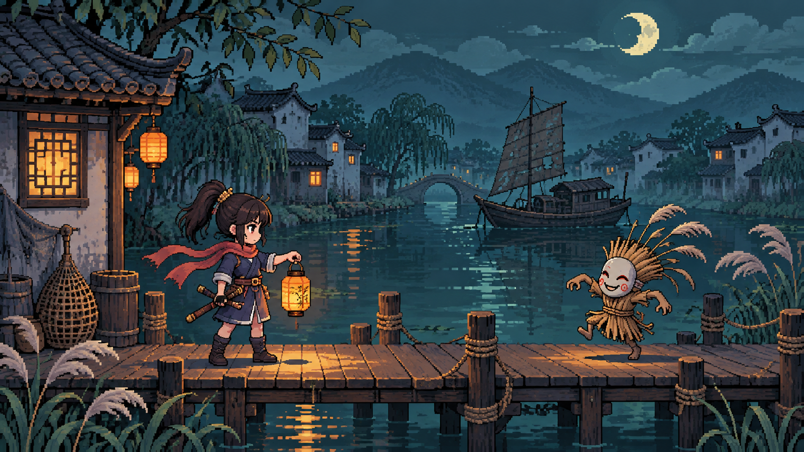

# 夜行斩妖录 · 游戏整体设计

设计版本 v2.3 ｜ 2026 年 11 月 23 日 ｜ 面向策划、美术、交互与开发

玩家是青芦村的守夜学徒阿照。她凭师父教的短刀和守式上山，在第一次战胜山君时觉醒天生的「观化」，能把亲历的妖魔武技与神通悟为己用。山上曾让她握不稳刀的那声虎啸，日后会从她口中发出，喝断渡口的回浪。

## 项目定案

| 决定 | 对玩家的意义 |
|---|---|
| 小妖一刀即斩，大妖按谱交锋、关键轮可应变，PC 浏览器优先 | 平时看阿照自行出招，遇到险招可停下来想一想。每战两点定神，重演默认自动。窄屏保留同一套规则。 |
| 国风二次元像素，冷夜色配纸灯，界面是一册巡夜手札 | 人和妖靠轮廓、表情与出招辨认。正文用清晰的现代中文排版，长时间看数值也舒服。 |
| 累计道行自动升境，可用道行用于学招和精通 | 短线有便宜的新招可试，长线有值得攒的境界。配招可免费改，探索打法的成本低。 |
| 小妖产道行和本地装备，大妖开地图、给首胜佩饰并可悟得传承 | 首胜山君后可以开启自动夜行，换地图能找更高阶装备，旧佩饰可按回合搭配。 |
| 九个境界作长线骨架，首版止于听息 | 第一卷从凡人接刀写到能照见妖影，把入道本身做成值得记住的一夜。 |

## 设计分册

写新卷时，先从[世界观与修行九境](世界观与修行九境.md)查明阿照为什么到此、当时能做什么、可凭哪项确定性进度破境。然后用[流派构筑与长线玩法](流派构筑与长线玩法.md)确定新传承占哪个槽、在哪一轮出手。首卷已上线的规则与数值以[玩法与数值设计](玩法与数值设计.md)和当前原型为准。

| 读者想解决的问题 | 对应文档 |
|---|---|
| 三位首领分别考什么？相同配装怎样打出不同结果？ | [首领战与临场应变](首领战与临场应变.md) |
| 后期招式怎样组成不同流派，第二卷起怎么避免数值膨胀？ | [流派构筑与长线玩法](流派构筑与长线玩法.md) |
| 这个世界为何闹妖？斩过的妖为何还能重打？九境如何得名？ | [世界观与修行九境](世界观与修行九境.md) |
| 角色、妖物、夜色怎么画？首页怎样排？破境、掉落以及按钮有哪些状态？ | [美术与界面规范](美术与界面规范.md) · [巡夜首页示意](美术参考/巡夜首页.png) |
| 怎样挂机、对战、结算和成长？遇到连续不掉落、断线或换招怎么办？ | [玩法与数值设计](玩法与数值设计.md) |
| 第一卷具体做哪些人、妖和关卡？之后怎么加内容？每轮怎样验收？ | [首卷内容与扩展计划](首卷内容与扩展计划.md) |

## 一次回到游戏的经历

玩家昨晚停在芦花渡。今天打开，先看到灯下的一笔离线道行，渡头的小妖已扫清，山道上的按钮提示挑战河伯。昨晚的战报显示第六轮被回浪击倒。玩家翻看招谱，发现山君教的《镇山喝》恰在第三、第六轮释放，决定装备它换成攻式。再次入水，河伯抬篙，主角一声喝止住回浪。回到首页，系在桩上的渡船第一次驶向对岸。玩家可以去白烛庙，也可以留在《斩妖录》里重演河伯一战，学它的身法。

## 范围与验收口径

首卷试玩包含一个村、三处巡夜地、六种小妖、三只大妖、三门专属传承与前四境。单人进度保存在当前浏览器，支持自动夜行的离线道行和首胜场景变化。

画风、核心循环和章节因果按本版执行。成本、概率、离线上限、战斗时长均为**原型起测值**。决定是否扩第二卷，看新玩家能否读懂失败、靠换招过关，并认出战后村子发生了什么。具体验收与下一阶段提示词见最后一册。

## 首卷试玩

[在线试玩《夜行斩妖录》](https://suwki.github.io/game/night-watch.html)

点「夜行」找小妖，第二只必掉松纹刀，可在掉落卡穿戴，也可点巡夜页兵刃槽更换。黑风岭累计斩 12 只后可挑战山君。首胜得山君牙坠、镇山喝招谱，并解锁可手动开启的自动夜行。战果页可直接学会并装备镇山喝，再去渡口夜行累积至舒筋。黑风岭、芦花渡、白烛庙分别在锻骨十层、舒筋十层、听息十层扫清，手动、自动和离线共用上限。河伯每三回合发一次回浪，镇山喝在对应回合自动截招。

本地开发时，在仓库根目录运行 `npm.cmd ci` 和 `npm.cmd run dev`，再打开[本地入口](http://127.0.0.1:5173/night-watch.html)。本地入口和线上地址各自保存进度。

三地分别在斩 12、100、140 只小妖时集齐线索，各自掉落 1、2、3 阶装备。战斗画面使用像素立姿与短动效，正式逐帧动画、环境音和真人试玩留在下一阶段。

下一阶段可直接使用这段提示词。

> 从新档试玩到第一次用《镇山喝》截断河伯回浪，分别记录等待时间、玩家预判的出招回合和做过的配招决定。根据结果调整道行产出和演出，再为三场首领战补齐前摇、受制和退场的逐帧动画。
