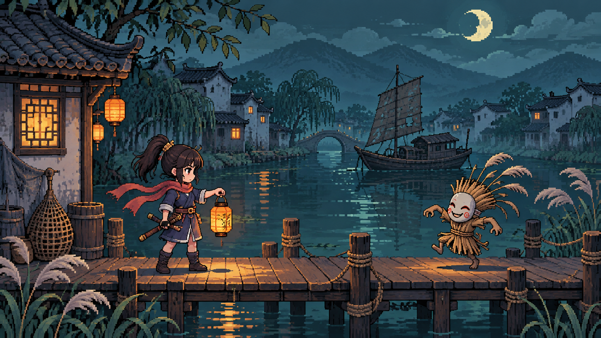
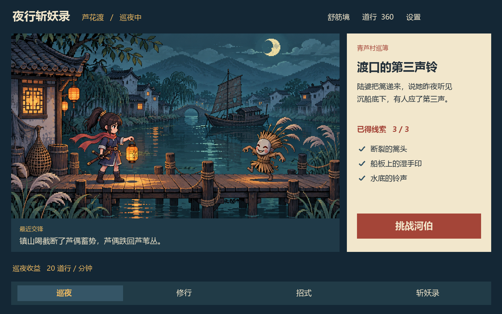

# 美术与界面规范

**原型已有。** 三张场景底图、阿照和九只妖物的像素立姿、双方气血、战场前摇和战报均可见。「招式」提供当前首领的前六轮招谱。首胜后渡口出现船，另外两地复用祠龛并用各自对白说明变化。顶栏可以关闭动效，820 像素以下切换为单列。下文的像素画布、动作帧数、音效与触控尺寸是量产规格。

## 定调与取舍

**战场画成横向像素戏台，角色按二次元方法设计，操作区做成夜巡手札。** 二次元主要落在头发、神情、手势和姿态上。阿照有一条能让玩家从余光里认出她的枣红头巾。山君肩高背低，未张口也能看出正在蓄力。让玩家多看一眼战斗，本身就是放置游戏的回报。

概念图供角色轮廓、灯火位置和场景层次对色，量产时另绘同网格的动作序列。水墨整屏插画适合卷首和过场，持续战斗时容易让雾气吞掉前摇；全屏大立绘适合人物初见，放回常驻主页会挤占敌我动作空间。第一卷把美术预算先花在三只大妖的起手和渡船复航上。

## 像素与色彩

| 对象 | 作画约定 | 验收时看什么 |
|---|---|---|
| 战场 | 基准画布 384×216，地表按 16×16 图块绘制。主角站姿约 40 像素高，小妖 24～36，大妖 56～88。放大用最近邻，优先整倍显示，余量交给边框。 | 还原到原尺寸时，主角、灯、大妖起手仍能辨认。 |
| 人物 | 约三头身，远景收眼鼻、留头巾与刀鞘。手札头像用 96×96 单独绘制，脸上保留眉眼和两级阴影。 | 取下名字后，立绘和战斗小人仍像同一个人。 |
| 环境 | 远山、屋脊、前景芦草三层。水面仅循环保留几道月痕。战斗线位于画面下方约四分之一处。 | 待机画面有灯芯和倒影轻动；战斗时芦花、飞虫都让开敌人脚下。 |
| 色板 | 墨靛 #142735 作底，青黛 #355566 作远景，纸白 #F2E7CC 作手札，墨字 #243039，灯金 #EDB961 表收益，朱砂 #A44538 表主操作及危险符记。 | 仅一个最亮的交互按钮。危险同时有形状和动词提示，和朱印按钮靠位置及形状区分。 |
| 动作与声响 | 待机 4 帧、巡行 6 帧、出刀 4～6 帧。每次危险招式都有预备姿态、地面符号、短音和收招停顿。待机风声与战斗鼓点用独立音量。 | 静音能看懂蓄势；关闭抖动与闪白后，战斗时序相同。 |

## 首页与导航

图为 PC 排版示意。战场、进度和主要操作可以同时看见。首胜过场只播一次，重演结束直接回手札。字体使用系统简体中文黑体；地名标题可用宋体。正文使用真字形，让用户可放大和选择；像素字只用于极短的装饰印记。

| 区域 | 显示与操作 |
|---|---|
| 顶栏 | 地点、境界、可用道行与设置。悬停或点道行可查看巡夜实测速率。 |
| 主战场 | 左侧主角，右侧来敌，留出约半屏显示前摇。默认合并伤害数字。挑战时顶端换为大妖血条和招式名。 |
| 右侧手札 | 当前妖案、已获得的证词、下一项明确目标。达到条件出现“挑战河伯”；未集齐则写明差哪条线索、去何处获得。 |
| 底部 | 常驻入口为巡夜、修行、招式、行囊、斩妖录。「夜行」放在战场下方，获得装备显示品名与阶级。战报保留最近一次关键交锋，点开查看详情。 |
| 窄屏 | 单列顺序为状态、战场、当前目标、底部导航。右栏收进可展开的手札。以 360 像素宽校验，按钮触控区至少 44×44 CSS 像素，正文从 16 CSS 像素起。 |

## 四个关键流程

1. **修行。** 点击境界可见当前收益、下一境能力、所需道行与剧情门槛。条件齐全时按钮显示“耗 330 道行 · 入听息”。明确消费后播放一次破境演出；允许跳过，能力即时生效。
2. **招式。** 卡面写明传承类别、来源、最低境界、入门或精通、首发轮与间隔。人物境界始终跟角色名显示；招式页使用“镇山喝 · 精通”这样的写法。已得传承说明敌我用法，例如“山君以啸伤人，阿照学它在第三轮截断回浪”。同槽装满时供玩家替换，心斋之后还可交换两门武学的位置。预览和战报均使用实际回合号。
3. **挑战与战报。** 开战前列妖相、已见前兆和当前策略。第一次遇见未知招时随动作短暂显示“山君伏肩 · 将啸”。失败页突出最后一次有意义的命中，按钮为“调整招式”和“再战”，关闭回巡夜。胜利页先给世界变化，再给传承结果与保底进度。
4. **离线归来。** 当前提示显示计入分钟及所得道行，超过八小时会标注上限。芦花渡离开两小时的例子是 6,750 道行。正式稿可并列显示实际离开时间与计入时长。关闭动效后仍应看得清起手和结算。

## 新手与功能指引

手札顶部一次显示一条指引。点击「知道了」可收起这条提示，顶栏「指引」可随时按主题回看并开启或关闭自动提示。开局指向「夜行」，拾到首件装备后指向行囊；第一次可战时引导查看前六轮招谱。山君首胜显示自动夜行解锁，后续按进度提示学习、装备与破境。到舒筋和听息才介绍身法、神通位。第一次用斩妖录时说明换路、重演和保底，招式有可精通项时显示其用途。

首败提示看掉血的轮次，累计二败再给一条具体解法。交锋详情提供回合数、双方剩余气血和逐轮记录。由战报打开招式时预览刚才的对手，修改后可直接再战。老档按实际进度显示合适的功能指引，已经完成的开局步骤自动跳过。

## 美术交付清单

首卷需要阿照一套动作及头像，三位人物的手札形象（含阿照），六只小妖、三只大妖各自的战斗动作，三处场景各一套平患前后差分，三张传承图标，以及架势、蓄势、回浪、真身四套形状提示。场景差分优先复用底图，例如在原渡口上增加船夫和一趟往返船。每只大妖交立姿、前摇、释放、受制、退场五类画格。美术与策划用同一张前摇表对齐关键帧。
